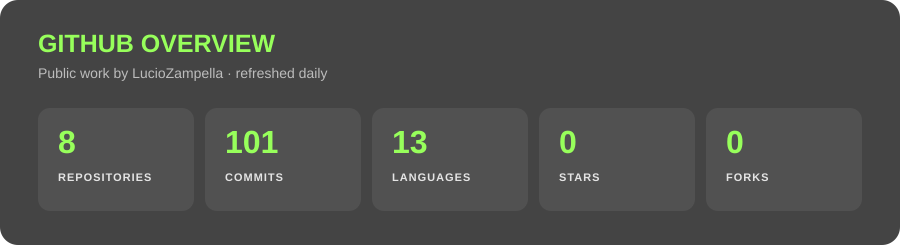
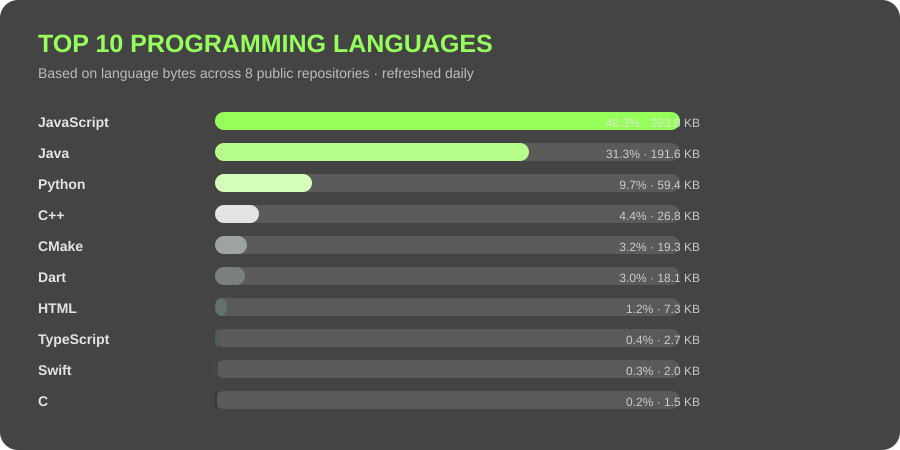

# Lucio Zampella

### Computer Engineering student · Designer · Problem solver

  Building at the intersection of <b>technology</b>, <b>hard sciences</b>, and <b>visual design</b>.

  

---

## About me

I am Lucio, a Computer Engineering student at **Universidad Austral** and a designer who works with tools such as **Photoshop**. I enjoy turning complex problems into clear, useful, and well-crafted solutions.

My interests span software, technology, hard sciences, and the point where engineering meets visual communication.

  

 

  

  Updated daily from my public and private repositories

  <a href="./assets/language-data.json">View the aggregate source data here</a>

